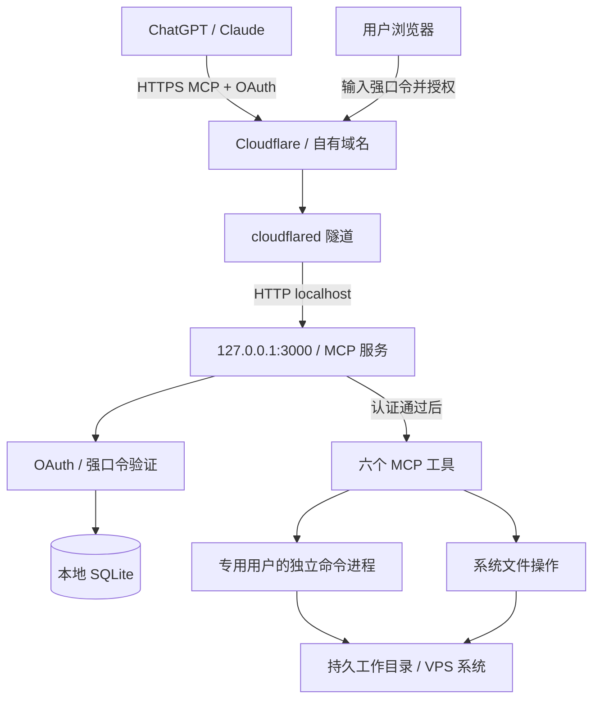

# milanoreal-mcp 设计方案

日期：2026-10-19

状态：当前实现的架构说明。原设计基线保存在标签 `v0.1.0-design`；六工具、OAuth 与 VPS 部署现已实现，两端核心功能已通过用户实测。逐项验收状态见 [PLAN.md](PLAN.md)，证据见 [验证记录](docs/verification.md)。

面向：个人使用的单台 Linux VPS，供 ChatGPT、Claude 的远程 MCP 客户端连接。

## 1. 目标与已确认的决定

把闲置 VPS 变成 LLM 可以持续使用的执行环境。用户在 ChatGPT 或 Claude 中提出任务，LLM 通过 MCP 执行命令、操作文件，下次对话可以继续使用已有项目和依赖。

| 项目 | 决定 |
| --- | --- |
| 执行位置 | 直接在 VPS 系统执行 |
| 系统身份 | 专用普通用户，本文示例为 `mcp` |
| sudo | 管理员自行选择是否授予；授予时使用免密 sudo |
| 环境生命周期 | 部署时准备，长期保留，随系统启动服务 |
| 持久化内容 | 文件、项目、用户安装的依赖及本地 OAuth 状态 |
| 命令模型 | 每次调用启动独立进程，不保持 Shell 或 Python 内存状态 |
| 任务记忆 | LLM 在项目内维护进度文件，通过普通文件工具读写 |
| 客户端关系 | 同一用户的所有连接共享 VPS、工作目录和文件 |
| 工具范围 | 沿用参考项目六个工具，删除 `container_initialize` |
| 外部入口 | Cloudflare Tunnel，绑定用户自己的域名 |
| 登录 | 标准 OAuth 授权流程，授权页面只需输入唯一强口令 |
| 技术方向 | TypeScript、Node.js、MCP SDK、本地 SQLite、systemd |

以下具体默认值是本方案的工程选择，可以在实现或部署时调整，无需改变上述方向。

## 2. 第一版范围

实现远程 MCP、六个工具、单用户 OAuth、系统用户执行、本地状态持久化和 systemd 部署说明。

第一版不实现容器、环境创建与重置、多租户、会话隔离、持久终端、交互式输入、任务调度平台、专门的记忆工具、网页文件管理器或文件下载服务。长任务可以由 LLM 通过 Shell 启动后台程序并读取日志，不为它增加工具。

服务器提供的是执行能力。关闭聊天后，已经启动且正确脱离请求的后台程序可以继续运行，但 MCP 不会自行调用模型、继续规划或自动推进下一步。

## 3. 总体结构

服务与执行命令使用同一个专用用户。服务启动时检查当前 UID，拒绝作为 root 启动。sudo 仅由命令显式调用，服务不主动提权。

VPS 上分为两个 systemd 服务：应用服务和 `cloudflared`。应用只监听 loopback，不增加公网入站监听；隧道需要正常的出站网络。HTTPS 由 Cloudflare 提供，本机回环转发使用 HTTP。[Cloudflare Tunnel 文档](https://developers.cloudflare.com/cloudflare-one/networks/connectors/cloudflare-tunnel/)

固定配置文件中的 `publicBaseUrl=https://mcp.example.com`。OAuth issuer、发现文档和所有本站跳转均由该值生成，不根据不可信的 Host 或转发头拼接。

## 4. 与参考项目的关系

参考 [Cloudflare sandbox-container](https://github.com/cloudflare/mcp-server-cloudflare/tree/main/apps/sandbox-container) 的工具划分、参数形式和文件内容返回方式。源码核对基线为该目录最近一次提交 `e4cf085520ea7286af77abf938d645c610ef1580`（2026-10-09）；所选 SDK 的实际 API、版本与许可证核对记录见 [依赖说明](docs/dependencies.md)。

上游初始化会销毁旧容器再创建新容器，运行逻辑要求容器预先启动，并存在不活动超时及生命周期回收。本项目保留工具概念，替换执行后端和生命周期，不能仅删除工具注册后直接运行上游代码。[生命周期源码](https://github.com/cloudflare/mcp-server-cloudflare/blob/e4cf085520ea7286af77abf938d645c610ef1580/apps/sandbox-container/server/userContainer.ts)

| 上游部分 | 本项目处理 |
| --- | --- |
| `container_initialize` | 删除，无替代工具 |
| `container_ping`、执行及文件工具 | 保留名称和主要参数 |
| Cloudflare Container、Durable Objects | 替换为本机进程和文件系统 |
| 模板镜像、快照、容器容量管理 | 删除 |
| 短期容器回收 | 删除，不回收工作文件与依赖 |
| Cloudflare 账号 OAuth | 替换为本站单用户强口令授权 |
| Workers KV 与观测依赖 | 替换为 SQLite 和 systemd journal |
| 提示词 | 改为真实 VPS、持久文件、独立命令、进度文件约定 |

沿用 `container_` 工具名前缀只为保持接口熟悉度，说明必须明确实际操作的是 VPS，不宣称提供容器隔离。

## 5. MCP 协议与 HTTP 路由

采用 MCP SDK 支持的 Streamable HTTP，入口为 `/mcp`。协议版本通过 SDK 协商，依赖精确版本由 `package-lock.json` 锁定，选型记录见 [依赖说明](docs/dependencies.md)。不手写 JSON-RPC 协议栈。

MCP 传输采用无状态模式，不依赖 MCP session ID 保存环境。客户端重新连接不会重建工作目录。协议握手按 SDK 正常处理；传输无状态不代表 OAuth 状态无持久化。

| 路径 | 作用 | 认证 |
| --- | --- | --- |
| `/mcp` | MCP 请求 | 每次请求验证 access token |
| `/.well-known/oauth-protected-resource/mcp` | `/mcp` 的资源元数据 | 公开 |
| `/.well-known/oauth-protected-resource` | 相同资源元数据的兼容入口 | 公开 |
| `/.well-known/oauth-authorization-server` | OAuth 授权服务器元数据 | 公开 |
| `/oauth/authorize` | 校验授权请求、展示登录与授权页面 | 公开入口，批准需要强口令 |
| `/oauth/approve` | 提交强口令及批准或拒绝 | 短期浏览器事务、CSRF 校验 |
| `/oauth/token` | 授权码兑换、刷新令牌 | 按 grant 类型校验 |
| `/oauth/register` | 动态注册客户端（DCR） | 公开入口，限制请求及数量 |
| `/healthz` | 仅返回服务是否存活 | 公开，不返回系统详情 |

资源标识统一为 `https://mcp.example.com/mcp`，issuer 为 `https://mcp.example.com`。两个资源元数据路径返回相同的 canonical resource。401 中明确提供实际元数据地址，避免客户端猜测路径。

`/mcp` 只接受 POST，使用 SDK 无状态传输及 JSON 响应；通知由 SDK 处理。其他 HTTP 方法在认证后返回 405，不提供 GET SSE 流、会话删除或 `/sse` 别名。校验请求 Origin（存在时）及预期 Host，允许没有 Origin 的合法服务端客户端；不使用放行所有来源的 CORS 配置。[Streamable HTTP 规范](https://modelcontextprotocol.io/specification/2026-07-28/basic/transports/streamable-http)

## 6. 单用户 OAuth

### 6.1 用户体验与身份

只有一个应用所有者身份，不需要用户名、注册、邮箱、第三方登录或账号管理界面。OAuth 登录口令独立于 Linux 用户密码，也不是 sudo 密码。

用户添加 MCP 地址后，客户端发现 OAuth 配置并打开本站授权页。页面显示请求的客户端、回调目标和“执行命令及操作该系统用户可访问文件”的授权含义；用户输入强口令并批准，浏览器返回客户端。之后客户端携带独立的令牌访问 MCP，不携带强口令。

强口令用于浏览器页面验证，不提供 OAuth password grant，不把它当固定 bearer token。口令只保存带盐的 Argon2id 哈希；初始化通过本地交互式管理命令完成，不在命令行参数或日志中传递明文。至少 20 个字符，输入不回显。

### 6.2 协议实现边界

按 OAuth 授权码 + PKCE S256 实现，使用成熟 SDK 或库完成可复用的校验。提供发现元数据、精确匹配的回调 URI、一次性授权码、资源绑定和 refresh token。只有 `mcp:access` 一个工具访问 scope；允许通过该授权签发刷新令牌，不另外引入 `offline_access` 或 OIDC 用户资料。

第一版只做 DCR（动态客户端注册），不同时实现 CIMD 和预注册客户端。ChatGPT 仍支持 DCR，Claude 提供“Register automatically”方式，这为个人部署提供了共同接入路径。CIMD 是协议推荐的后续方向，当前不为它增加远程文档抓取、缓存和 URL 校验逻辑。[OpenAI OAuth 接入文档](https://developers.openai.com/plugins/build/auth)、[Claude 连接配置](https://support.claude.com/en/articles/11175166-get-started-with-custom-connectors-using-remote-mcp)

第一版采用 public-client + PKCE，token endpoint 认证方式为 `none`；`none` 表示不用 client secret，不代表授权码或 verifier 可以缺失。只发布 DCR 和已测试的能力，不宣称支持 CIMD、`private_key_jwt` 或 confidential client。注册本身不授予工具权限。

发现元数据明确发布 `registration_endpoint`、`code_challenge_methods_supported: ["S256"]`、`grant_types_supported: ["authorization_code", "refresh_token"]`、`response_types_supported: ["code"]` 和 `token_endpoint_auth_methods_supported: ["none"]`。DCR 只接受并返回这一组实际支持的客户端参数；缺省值也按 DCR 规范处理，不能把缺少认证方式的请求静默解释成 `none`。如果客户端请求不受支持的方式，明确返回注册错误并在最小接入验证阶段解决。[DCR 规范](https://datatracker.ietf.org/doc/html/rfc7591)

授权服务器元数据另发布 `authorization_response_iss_parameter_supported: true`，成功和错误授权回调都返回与元数据完全一致的 `iss`。这是同一个 OAuth 流程的必要配置，不能只在回调中添加字段却遗漏对应声明。

部署配置明确允许的回调 URI。回调不允许通配符或前缀匹配；在注册、授权、兑换时使用同一个已校验值。客户端名称是显示信息，不能作为身份认证依据。新回调未被允许时明确拒绝，管理员核对客户端显示的实际地址后更新配置并重试；不自动信任注册请求提供的地址。

DCR 仅保存所需客户端元数据，不主动抓取客户端提供的 logo 或其他 URL。两端真实客户端已确认 DCR + PKCE + `none` 可完成授权；如果实测要求其他方式，只补充有证据需要的机制，不提前实现三套注册方式。

按标准处理 `state`（原样返回客户端提供的值）、`resource`、scope、PKCE 和授权响应 issuer。本站另用不可预测的授权事务 ID、短期 HttpOnly/Secure/SameSite cookie 及 CSRF token 绑定批准操作。授权事务保存服务器校验后的参数，提交页面不能自行更换 client 或 redirect URI。

错误回调也携带 issuer；只有在客户端及回调地址已经验证后才重定向，否则在本站返回错误。令牌只通过 Authorization header 使用，所有 MCP 方法均校验，不接受 URL 中的 access token。[MCP 授权规范](https://modelcontextprotocol.io/specification/2026-07-28/basic/authorization)

### 6.3 授权流程

1. 未认证的 MCP 请求得到 401 和带资源元数据地址的 `WWW-Authenticate`。
2. 客户端发现授权服务器，通过 DCR 得到客户端 ID；注册记录不等于用户已授权。
3. `/oauth/authorize` 校验客户端、回调、resource、scope 和 PKCE，创建有效期 10 分钟的浏览器事务。
4. 用户输入强口令并批准；拒绝则返回 `access_denied`。
5. 生成有效期 60 秒、只能消费一次的授权码，绑定客户端、回调、scope、resource、PKCE 及授权记录。
6. 客户端在 `/oauth/token` 提交授权码和 verifier；原子消费授权码，签发 access token 和 refresh token。
7. 每次 MCP 请求验证令牌及所属连接授权的到期时间、撤销状态、授权版本、resource 和 scope，再进入协议处理及工具。
8. 刷新时原子轮换 refresh token；服务重启后仍可从 SQLite 继续验证。

### 6.4 令牌与管理

| 对象 | 设计默认值 |
| --- | --- |
| Access token | 不透明随机值，至少 256 位随机性，有效期 1 小时 |
| Refresh token | 不透明随机值，至少 256 位随机性，连接授权有效期 90 天；轮换不延长这一期限 |
| Refresh 轮换 | 每次替换；保留旧 token 哈希以检测重放，重放时撤销对应授权族 |
| SQLite 中的 token | 仅保存哈希及绑定关系，不保存明文 bearer token |
| 浏览器事务与授权码 | 短期内存记录，一次性消费；重启后重新发起尚未完成的登录 |
| 已批准客户端记录 | 保留至显式删除，不因清理短期 token 而删除有效客户端 |

ChatGPT 和 Claude 各自建立授权，任一端断开不影响另一端。刷新到期或轮换冲突导致拒绝时要求重新连接，不绕过认证；对客户端并发刷新行为做集成验证。

第一版的本地管理入口只提供初始化/更换强口令、撤销全部授权。更换强口令时同时撤销全部旧授权。先不做授权列表、单连接撤销或额外 HTTP 撤销端点。全部撤销立即使关联 access token 和 refresh token 无效；不会终止已经执行中的系统进程。客户端“断开连接”不等于服务端立即撤销，必要时通过本地入口执行全部撤销。

设置中保留一个单调递增的 `authGeneration`。浏览器事务、授权码和连接授权都绑定其创建时的版本；更换口令或全部撤销时，在数据库事务中递增版本。批准、兑换、刷新和新 MCP 请求均检查数据库中的当前版本，持久令牌的签发与版本检查处于同一个事务中。批准时读取当前版本的口令哈希，不长期缓存旧哈希。这样本地管理命令即使由另一个进程运行，也能让服务内存中的旧登录事务及授权码失效，不必增加进程间通知。已在执行中的命令不受追溯影响。

登录和 DCR 实施有界的内存限速。暂定每来源地址每 15 分钟允许 5 次失败口令尝试；另设全局并发验证上限，避免昂贵口令哈希挤占服务，不做长期全局账号锁定。被限速返回 429 和重试提示。来源地址仅在确认请求来自配置好的 loopback 隧道入口时读取可信的 Cloudflare 转发头，不能无条件信任外部同名头。限速窗口可随服务重启清空，不为它增加数据库表。

DCR 的未授权记录单独限额，暂定最多 128 条，超过时清理最早且从未获得用户批准的记录；这些记录最多保留 24 小时。至少获得过一次批准的客户端记录不因这个限额或 token 清理被删除，全部撤销也保留这些 client ID，使客户端可重新登录而不必重新注册连接。丢弃尚未批准的注册记录后，首次连接可能需要重新添加或自动注册，属于明确的失败恢复行为。

## 7. 六个工具的接口与语义

保留上游 `args` 嵌套输入形式，减少接口差异。命令文本仍叫 `args`，不是命令参数数组。所有路径采用本机文件系统语义：相对路径从固定工作目录解析，绝对路径保持绝对路径，`~` 只明确展开为当前用户 home。不依赖调用之间的 `cd`。

### 7.1 工具表

| 工具 | 输入 | 行为 |
| --- | --- | --- |
| `container_ping` | 无 | 确认服务可以启动普通命令、工作目录可访问，返回用户、工作目录和可用状态 |
| `container_exec` | `{ args: { args: string, timeout?: number, streamStderr?: boolean } }` | 在固定工作目录启动独立非交互 Shell，返回输出、退出码、超时与截断信息 |
| `container_file_write` | `{ args: { path: string, text: string } }` | 写 UTF-8 全量内容，必要时创建父目录，存在时覆盖 |
| `container_files_list` | 无 | 列出固定工作目录的第一层条目，包括隐藏条目，排序，返回类型及资源 URI |
| `container_file_read` | `{ args: { path: string } }` | 读取普通文件，或列出给定目录的第一层条目 |
| `container_file_delete` | `{ args: { path: string } }` | 删除文件、链接或递归删除目录，不存在则明确报告 |

`timeout` 单位为毫秒，必须为正整数；`streamStderr` 默认 true，其历史名称保留，实际只表示是否把 stderr 放入最终响应，不承诺实时流式显示。

Linux 用户权限是文件访问边界，工作目录只是默认起点，不做伪沙箱路径限制。文件工具不自动使用 sudo；需要提权的文件操作由 LLM 通过 `container_exec` 显式使用 `sudo -n` 执行。

写入使用 Node 文件 API，删除和列目录也避免把路径插入 Shell 命令。拒绝空路径和 NUL；兼容 `file://` URI 时使用标准解析并拒绝远程 authority。删除符号链接只删除链接本身，目录递归不沿链接遍历。

### 7.2 内容与返回格式

执行结果同时提供可读的文本内容和结构化字段：`stdout`、`stderr`、`exitCode`、`signal`、`timedOut`、`truncated`、`outputIncomplete`、`durationMs`。正常非零退出码或超时是工具执行失败，用 `isError: true` 返回已有输出，不能只抛异常丢掉诊断。`streamStderr=false` 时不展示 stderr，但仍排空其管道。

文本文件返回 MIME 类型、URI 和文本。二进制普通文件返回带 MIME 类型的 MCP embedded resource（base64 blob），不保证所有客户端都能直接展示或下载；图片内联返回方式在客户端验证后再决定是否补充。目录返回稳定排序的条目，不跟随链接递归遍历。

资源 URI 仅标识 VPS 路径，不表示用户的本地文件或公网下载地址。服务不宣称支持未实现的 `resources/read`；文件内容通过 `container_file_read` 获得。

### 7.3 大小及并发限制

| 项目 | 初始默认值 |
| --- | --- |
| 同步命令默认超时 | 60 秒 |
| 同步命令最大超时 | 90 秒，作为工程常量按实测调整 |
| 执行结果输出 | stdout + stderr 合计最多 128 KiB |
| 单文件读取或写入 | 原始内容最多 1 MiB |
| 单次目录列表 | 最多 1000 条，列表 JSON 数据最多 256 KiB；MCP 包装和文本副本另有开销 |
| HTTP 请求体 | 最多 8 MiB，容纳 1 MiB 文件内容的 JSON 转义开销 |
| 并行前台命令 | 最多 2 个，额外调用立即返回 busy，避免排队耗尽客户端等待时间 |

超出最大 timeout 的请求返回参数错误并告知上限，不悄悄改变用户传入值。输出达到上限后继续排空管道并丢弃超出部分，不能因停止读取造成子进程阻塞，也不能缓存无限输出。截断按有效 UTF-8 边界处理。

目录枚举达到数量或大小上限就停止，返回已收集并排序的条目及截断标记，不先收集整个目录再截断。大文件不整体读入内存再检查大小，而是先检查并限制实际读取量；拒绝设备、FIFO 等非普通文件，避免无限读取或阻塞。超限响应指导 LLM 使用 Shell 的 `head`、`tail`、分片读取或脚本处理，不为第一版增加分页工具。

默认 60 秒、最多 90 秒是服务端执行预算，不是客户端等待时长的保证。Cloudflare 有代理等待限制，实际可用时长也取决于客户端，不能仅提高服务端 timeout 就承诺更长同步执行。如果实测客户端更早断开，应下调默认值并提示 LLM 使用后台执行。部署后通过真实隧道验证这些值。[Cloudflare 524 文档](https://developers.cloudflare.com/support/troubleshooting/http-status-codes/cloudflare-5xx-errors/error-524/)

## 8. 命令进程、环境和后台任务

使用固定 `/bin/bash -c`，从工作目录启动非交互、非 login Shell。不自动读取用户交互式 `.bashrc`，不隐式持久化 `export`、`cd` 或虚拟环境激活状态。要改变目录或使用 Python venv，应在同一次命令中明确指定。

子进程只接收整理后的 HOME、USER、LOGNAME、SHELL、LANG、PATH、TMPDIR 和固定 TERM。当前无自定义执行环境配置，不继承应用 OAuth 配置、HTTP 凭据或隧道凭据。PATH 包含当前 Node 可执行文件目录、系统常用目录及用户的 `.local/bin`，具体工具链由部署者准备。

每次前台执行创建独立进程组，stdin 直接关闭，避免命令等待交互输入。达到 timeout 时向该进程组发送终止信号，最多等待 1 秒后发送强制终止信号，再有界收尾并返回已有输出；不无限等待进程退出。HTTP 连接意外断开或客户端停止等待，不推断为命令已取消，执行仍受原 timeout 约束；不自动重跑。第一版不增加跨 HTTP 请求的取消通知路由，也不承诺传输断线后的结果重放或自动去重。

进程组信号只能作用于当前用户有权操作、且仍在该组内的进程。sudo 提权后、另建会话或已交给系统服务管理的进程不保证被终止；信号调用成功也不证明组内所有进程均已结束。遇到权限或清理失败，结果应明确报告，`timedOut` 只表示超时并已尝试终止，不等于整项任务已停止。本项目不为更强的清理承诺增加特权代理或强制沙箱。[Linux 信号权限](https://man7.org/linux/man-pages/man2/kill.2.html)

需要主动提前停止时，有空闲执行槽才可由另一次命令检查并终止目标进程；两个槽都被占用时，该调用同样返回 busy，应等待原调用超时或由管理员通过 SSH 处理。不增加保留控制槽或专用停止工具，不能只根据客户端的停止按钮判断系统任务状态。

不能把 Shell 已退出等同于 stdout/stderr 都已关闭。Shell 退出后最多再排空 250 毫秒，若后代仍持有管道就停止采集并标记 `outputIncomplete`，及时返回；timeout 后也使用相同的有界收尾。即使父进程结束、管道不关闭或终止信号没有及时生效，也不能无限占用请求和执行槽。[Node 子进程说明](https://nodejs.org/api/child_process.html)

后台任务需要主动脱离请求：使用 `setsid` 等方式脱离当前进程组，并断开 stdin、把 stdout/stderr 重定向到日志，记录 PID 或可验证的任务标识。`nohup` 只处理挂断信号，单独使用它或 `&` 都不保证脱离进程组及管道。只有已脱离原进程组的任务才不会被该调用的进程组 timeout 终止；后台进程不计入两个前台命令槽。

普通 MCP 断线不会终止正确脱离的后台任务。第一版 systemd 单元明确采用默认的 `KillMode=control-group`：停止或重启应用会清理该单元 cgroup 内的后台进程，`setsid` 无法让它们离开这个 cgroup。需要跨应用重启长期运行的程序应由管理员另行交给独立系统服务管理；项目不提供这套管理能力。VPS 重启、OOM 等也可能结束进程，进度文件不会保存进程或内存状态。[systemd 进程清理规则](https://www.freedesktop.org/software/systemd/man/latest/systemd.kill.html)

sudo 使用 `sudo -n`，没有免密权限就快速返回失败。不通过 MCP 提示输入 sudo 密码，不使用伪终端自动回答交互确认。

不同调用及客户端可以同时读写文件；除单次 OAuth 状态变更的事务和必要文件写入处理外，不提供项目级锁或全局命令串行化。进度记录按项目分开，避免多个任务覆盖同一个总进度文件。

## 9. 给 LLM 的环境说明

通过 MCP server instructions 和工具 description 提供以下事实，不创建额外的记忆工具：

- 这是专用普通用户可访问的真实 VPS，文件长期保留，运行命令无需初始化环境。
- 展示真实用户名、固定工作目录、Shell、超时和大小限制，不编造预装软件。
- 每次命令独立，跨调用不保存 Shell 当前目录、环境变量或 Python 对象。
- 开始处理已有项目时，先查看项目说明和该项目的 `PROGRESS.md`（存在时）。
- 在关键步骤、耗时操作启动及结束、准备交接时更新进度；记录目标、已完成步骤、路径、后台标识、日志、下一步和更新时间。
- 恢复时检查文件、日志及进程实际状态。进度文件是辅助记录，PID 可能复用，不能仅据旧 PID 断言任务仍在运行。
- 长任务通过后台执行和日志管理；不要反复重试结果未知的写入、安装或其他有副作用命令。
- 不在进度文件中记录口令、token 或其他凭据。

不承诺客户端一定遵守提示词；协议和操作系统权限不依赖这些文字才能正确工作。

## 10. 本地目录、配置与数据

以下路径是建议布局，可配置，代码与运行数据分离：

| 路径 | 内容与所有权 |
| --- | --- |
| `/opt/milanoreal-mcp` | 应用及依赖，管理员部署，应用用户只读 |
| `/etc/milanoreal-mcp/config.json` | 公网地址、本地端口、目录和允许的回调 URI |
| `/var/lib/milanoreal-mcp/state.sqlite` | 应用用户可写的 OAuth 与管理状态 |
| `/home/mcp/workspace` | 项目、输入输出、脚本及每个项目的进度文件 |
| systemd journal | 运行及错误日志 |
| cloudflared 自身配置目录 | 由其服务管理，不传给执行子进程 |

配置只暴露 `publicBaseUrl`、`listenPort`、`workspaceDir`、`stateDir` 和允许的回调 URI；监听固定为 `127.0.0.1`。命令、请求体、文件和并发限制先使用本文中的具名常量，不把所有内部参数都做成部署配置。只提供一个配置文件来源，后续有实际需要再增加选项。

启动时拒绝缺失公网 HTTPS 地址、root 身份、缺失强口令初始化状态、无法访问的工作目录和损坏数据库。缺失状态不能自动退回无认证模式。

持久化只保存重启后继续连接所需的四类数据，物理表为 `settings`、`clients`、`grants`、`tokens`，schema 版本使用 SQLite `PRAGMA user_version`，不为短期状态单独建设存储层：

| 数据 | 主要内容 |
| --- | --- |
| 设置 | 口令哈希、全局授权版本 `authGeneration`（表中字段为 `generation`） |
| 客户端 | client ID、允许的回调、创建时间和首次用户批准时间 |
| 连接授权 | 所属客户端、授权版本、撤销状态和固定到期时间 |
| 令牌 | access/refresh 类型、哈希、授权绑定、到期和刷新消费状态 |

未完成的浏览器事务、一次性授权码和限速窗口放在有上限的内存容器中；服务重启时这些短期状态丢弃，用户重新开始登录。已完成的连接授权和 refresh token 不受影响。数据库事务用于持久令牌轮换及撤销；内存中的授权码必须在异步签发前原子认领，签发失败要求重新授权，不恢复旧码以免重放。

采用事务、外键、索引和有界的过期清理。启用 WAL 时备份通过 SQLite 备份机制或停服一致性复制，不能只复制仍在使用的主数据库文件。升级前备份，schema 不受支持或初始化失败就停止启动，不清空已有授权。

运行数据目录权限为 0700，数据库为 0600。执行用户和应用是同一信任主体，因此该用户的任意命令仍可能访问应用可读的数据；文件权限和子进程环境清理不构成对已授权 Shell 的隔离。授予完整免密 sudo 后，该信任范围进一步包含整台 VPS，这符合本项目的权限选择。

## 11. Cloudflare Tunnel 与部署

使用长期保留的 Tunnel 和稳定自有域名，不以临时 Quick Tunnel 域名作为正式 OAuth issuer。Tunnel 可以由用户现有方式管理，本项目不自动创建或修改 Cloudflare 账号资源。

把该 hostname 的全部路径转发到 `http://127.0.0.1:3000`，包括 `/mcp`、`/.well-known/`、`/oauth/` 和健康检查；不能只转发 `/mcp`。若使用本地 ingress 配置，未知 hostname 使用兜底拒绝规则。[Tunnel 路由文档](https://developers.cloudflare.com/tunnel/concepts/routing/)

这些路径不启用缓存，不叠加需要浏览器登录的 Cloudflare Access 拦截，也不对 MCP、token、发现端点启用浏览器挑战。授权由应用 OAuth 负责。Tunnel 仍然经过 Cloudflare 的代理和规则，需确保它们不拦截合法服务端请求；Tunnel 本身不等于 OAuth 认证。

部署步骤：

1. 管理员创建专用普通用户和持久工作目录，准备所需工具链。
2. 选择是否给该用户配置免密 sudo；应用不修改 sudoers。
3. 安装应用、设置配置和目录权限，通过本地管理入口初始化强口令。
4. 安装以该用户运行的 systemd 单元，设置工作目录、自动重启和 journal 日志。
5. 启动应用，检查 loopback 健康和发现文档。
6. 用用户已有 Cloudflare Tunnel 绑定正式域名并转发全部路径。
7. 从公网检查发现文档中的 issuer、resource、端点和 HTTPS 地址。
8. 在 ChatGPT 与 Claude 配置连接，取得实际回调信息并配置允许项，完成授权及工具验证。

systemd 配置不能无条件启用会阻止 sudo 的 `NoNewPrivileges` 或与预期系统访问冲突的文件系统保护选项；单元限制需要与“可选免密 sudo”这一已确认要求一致。

## 12. 实现组织

采用单进程服务和单个本地数据库，避免为此增加 Worker、Redis 或单独的身份平台。HTTP 层使用一个薄路由层，MCP 处理交给官方 SDK。

以下只划分职责，方便审查遗漏，不要求建立八套独立目录、接口层或抽象。第一版可以合并在少量文件中，不引入插件系统、通用仓储层或依赖注入框架：

| 模块 | 职责 |
| --- | --- |
| `config.ts` | 配置读取、启动验证与限制 |
| `app.ts` | 路由、请求体限制、Origin/Host 校验及错误映射 |
| `tools.ts` | server instructions、六个工具注册和结果格式 |
| `execution.ts` | Shell 启动、环境、管道、进程组、timeout 和并发 |
| `filesystem.ts` | 路径、目录、文本与二进制文件操作 |
| `oauth.ts`、`app.ts` | 发现、DCR、浏览器事务、授权码、token 与全部撤销 |
| `store.ts` | SQLite 表、事务、schema 版本检查和清理；备份按运维文档停服复制 |
| `admin.ts` | 本地初始化口令与授权管理 |

核心业务不依赖 Cloudflare API；换用其他公网入口时，只需调整入口和 `publicBaseUrl`，变更 issuer 后重新连接授权。

## 13. 验证与验收

实施阶段针对真实边界写测试，不为工具注册名称等低价值细节堆叠测试。完成以下验收才称为可用：

| 范围 | 验收行为 |
| --- | --- |
| 实际客户端 | ChatGPT 和 Claude 各完成发现、注册、强口令授权、六工具调用和重新连接 |
| 客户端覆盖 | 记录实测网页/桌面/手机端及账号权限；未实测不承诺支持 |
| OAuth 拒绝路径 | 错误口令、过期/重放授权码、错误 verifier、错回调、错 resource、过期/撤销 token 均被拒绝 |
| OAuth 持久化 | 应用重启后客户端可继续使用有效授权并刷新；口令更换和撤销立即阻止新调用 |
| 撤销竞态 | 更换口令或全部撤销后，旧浏览器事务、尚未兑换的授权码及并发刷新都不能签出新有效令牌 |
| 公开注册 | 未登录注册超额不会清除已批准客户端或形成需要手动重置才能解除的永久拒绝 |
| 刷新 | 轮换、并发请求、重放检测、过期和客户端断开分别验证 |
| 身份与权限 | 命令显示专用用户身份；无 sudo 正常失败，部署选择免密 sudo 后 `sudo -n` 成功 |
| 文件持久化 | 写入文件、创建项目或依赖后重连及重启应用，内容仍在 |
| 文件语义 | 相对/绝对路径、空格、Unicode、符号链接、目录递归删除和系统权限错误符合设计 |
| 大内容 | 输出截断不阻塞进程；超大文件和请求有界拒绝，不读入无限内存 |
| 执行 | stdout/stderr、非零退出、普通同用户进程组的 timeout 清理、清理失败报告、并发 busy 和非交互环境均验证 |
| 不确定结果 | 断开连接不触发自动重跑，不把网络错误报告成“命令未执行” |
| 后台任务 | 完全脱离后的进程在聊天断开后继续；服务重启的限制如实说明 |
| 公网隧道 | 正式域名下端点不被缓存/挑战，OAuth 返回公网 HTTPS，超时结果能在代理关闭前返回 |
| 运维 | 数据库迁移、备份恢复、日志脱敏、root 启动拒绝和配置错误可定位 |

Claude 的远程连接由 Anthropic 云端发起，即使用户在桌面或手机使用也不能仅依赖客户端本地网络可达。因此验证必须经过正式公网 Tunnel，而不是只在 VPS 上调用 localhost。[Claude 远程连接文档](https://support.claude.com/en/articles/11175166-get-started-with-custom-connectors-using-remote-mcp)

## 14. 实施顺序与部署时填写的信息

实施顺序与完成状态以 [PLAN.md](PLAN.md) 为准。先用正式 Tunnel 和临时无副作用工具确认两端认证及调用，再实现六个正式工具。两端核心执行与文件读写删除已通过；真实客户端刷新、撤销等剩余项目仍单列验收，没有以基础互通代替完整链路。开发验证不公开无认证执行入口。

验证记录分别标明本地自动化、VPS 隔离自检与用户实测。未记录的网页/app/手机端入口及账号范围不推断为已验证；兼容机制只根据实际问题补充。

开始编码不需要继续扩展需求。部署时填写以下信息即可：

- 正式域名和 Tunnel 的现有管理方式。
- 专用用户、实际 home、工作目录和所需工具链。
- 是否已授予免密 sudo，以及具体 sudoers 范围。
- ChatGPT/Claude 选用 DCR（自动注册），记录其实际回调 URI。
- 用户通过本地初始化入口设置的强口令，不在设计文档或聊天中收集。

上述部署信息只写入私有配置或本地管理状态。公开仓库不保存实际口令、token、数据库、SSH 登录信息或 Cloudflare Tunnel 凭据。完整安装与运维步骤见 [部署说明](docs/deployment.md) 和 [运维说明](docs/operations.md)。

## 15. 审查结论

总体架构自洽，未发现需要改变方向的阻断项。持久工作目录、六个工具、单用户 OAuth、本地 SQLite 和 Tunnel 都有明确用途；执行环境本身无需会话管理或任务平台。

复杂度主要集中在 OAuth，这是客户端协议接入的成本。第一版只选一条 DCR 路径，保留成熟库能够覆盖的协议校验、刷新与基本限制，不实现多种注册方式、特权进程管理器、取消分发、细粒度授权管理或可插拔框架。模块清单只是职责划分，可以合并到少量文件。

所选 SDK、正式 Tunnel 与两端核心功能已有实际证据；刷新、撤销、客户端等待时间及恢复流程仍按计划完成验收。超时和信号是有界执行控制，不是对 sudo 命令和全部后代的强制隔离保证。首个实现标签作为预览快照发布，不等同于所有验收项均完成。
